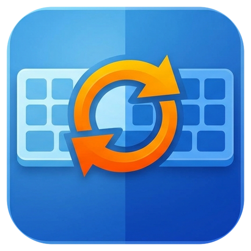

<p align="center"></p>

# KbSwitch

> ⚠️ **Alpha software**: expect bugs.

Small Windows app that **automatically switches the keyboard layout depending on the foreground application**.

Typical case: an AZERTY PC and a game that doesn't support AZERTY. KbSwitch switches to QWERTY when the game gets focus and back to AZERTY when you Alt+Tab out. Any pair of layouts installed in Windows works.

https://github.com/user-attachments/assets/1533e9a0-ca44-4016-a59d-1df5ed638a6d

## Features

- One rule = one program (`cs2.exe`) → one keyboard layout.
- A default layout for everything else.
- Open-windows list to create a rule with a double-click (Windows system processes are hidden, with an option to show them).
- Lives in the system tray; the close button can either minimize to the tray or quit.
- Optional start with Windows.
- No polling: Windows notifies KbSwitch when the foreground window changes.

## Install

1. Install the [.NET 8 Desktop Runtime](https://dotnet.microsoft.com/download/dotnet/8.0) (or newer) if you don't have it.
2. Download `KbSwitch.exe` from the [Releases](https://github.com/crazyball/KbSwitch/releases) and check its SHA-256 against the provided checksum:
   ```powershell
   Get-FileHash .\KbSwitch.exe -Algorithm SHA256
   ```
3. Run it. Windows SmartScreen may warn while the exe is not signed and not yet widely downloaded: **More info → Run anyway**.

## Usage

1. Open the window (double-click the tray icon).
2. Pick a layout in the **Layout** box, select a program in the left list, then double-click it or press **Assign →**.
   > **Note:** KbSwitch can only list and switch between the keyboard layouts that are **already installed in Windows**; it cannot add new ones. To add a layout (for example US QWERTY next to French AZERTY), see Microsoft's guide: [Manage the language and keyboard/input layout settings in Windows](https://support.microsoft.com/en-us/windows/manage-the-input-and-display-language-settings-in-windows-12a10cb4-8626-9b77-0ccb-5013e0c7c7a2). Then press **Refresh** in KbSwitch (or restart it) to see the new layout.
3. Open the **Settings** menu:
   - **Default layout**: the layout used for every program that has no rule.
   - **Start with Windows**: launch KbSwitch hidden in the tray at sign-in.
   - **Start minimized in the tray**: start KbSwitch hidden in the tray instead of showing the window (the `--tray` command-line argument does the same for a single launch). Start with Windows always starts hidden.
   - **Keep running in the tray when the window is closed**: ticked by default. Untick it if you want the close button to quit instead (the automatic switching stops when KbSwitch is closed). You can always use **File → Quit**.

The config is stored in `%APPDATA%\KbSwitch\config.json`. Set the `KBSWITCH_CONFIG` environment variable to a full file path to use another config file (handy for testing).

## Known limitations

- **Game running as administrator**: run KbSwitch as administrator too, otherwise Windows blocks the layout-change message.
- **Anti-cheat**: KbSwitch injects nothing and never reads other programs' memory. It listens for foreground-window changes and posts a layout-change message, like the Windows Alt+Shift shortcut does. There is no guarantee with any given anti-cheat: **use at your own risk**, especially in competitive games.
- The Windows Alt+Shift shortcut can clash with game keys; you can disable it in the Windows language settings.
- Config keys depend on the Windows display language: changing it can orphan existing rules.

## Privacy

No data is sent anywhere. KbSwitch does not use the network; the only outgoing action is opening the project page in your browser when you click the link in **Help → About**.

## Build

Requires the .NET 8 SDK. On Windows:

```powershell
dotnet publish -c Release -r win-x64 --self-contained false -p:PublishSingleFile=true -o publish
```

or run `build.bat`. The result is `publish\KbSwitch.exe`.

Official binaries are built by [GitHub Actions](.github/workflows/build.yml) from a tagged commit and published on the [Releases](https://github.com/crazyball/KbSwitch/releases) page together with their SHA-256 checksum.

## License

[MIT](LICENSE) © Holocron Factory (Loïc Ambrosini - CraZyBaLL)

The demo video uses the music "Happy Beats / Business Moves Vol. 9" by Sascha Ende ([ende.app](https://ende.app/en)), licensed under [CC BY 4.0](https://ende.app/en/standard-license), and sound effects by [Kenney](https://kenney.nl/) and unicae_games ([OpenGameArt](https://opengameart.org/content/keyboard-soundpack-1-typing-and-single-keystrokes)), both CC0.
